  

 

  

---

## ◤ КТО ЭТО ТУТ ◢

Студент-медик из Нижнего, который пишет софт на стыке  
**ИИ, медицинских данных, бэкенда и будущих биотехнологий.**

Мечтаю о протезах, имплантах и нейроинтерфейсах.  
Клиническая медицина — не моё. Хром — моё.

---

## ◤ ЛИСТ ПЕРСОНАЖА ◢

<!--EXCUSE:START-->
> 💬 **Оправдание дня (20.11.2026):** Чумба, это временное решение. Ему уже три месяца.
<!--EXCUSE:END-->

---

## ◤ ТЕХНОЛОГИЧЕСКАЯ МАТРИЦА ◢

Иконки не врут. Почти. Остальное гуглится за 30 секунд.

---

## ◤ ОФИЦИАЛЬНО О МОЁМ УРОВНЕ ◢

| Параметр | Значение |
|---|---|
| Уровень разработчика | «Senior», если считать часы без сна |
| Любимый баг | тот, что исчез сам и никому не сказал |
| Отладка | `print("here")`, потом `print("here2")`, потом молитва |
| Рабочее время | с 22:00 до «ну я же только сел» |
| ОС | Fedora, потому что страдать надо красиво |
| Любимый язык | C++, а ещё Python, когда лень страдать |
| Код-ревью | сам себе, самый предвзятый судья в мире |
| «У меня на машине работает» | сертифицировано |

---

## ◤ ACTIVE PROJECTS ◢

<table>
<tr>
<td width="50%">

### 🏥 MedReg AI

Intelligent patient routing based on neural text analysis.

**Medical complaint → symptom analysis → specialist recommendation**

</td>
<td width="50%">

### 🕷 Tick Defender Bot

Educational Telegram bot for tick-borne encephalitis prevention and public health awareness.

**Medical education → prevention → public health**

</td>
</tr>
</table>

---

## ◤ ТЕЛЕМЕТРИЯ GITHUB ◢

  

---

## ◤ СВЯЗЬ ◢

  

**Открыт для коллабов в MedTech / AI / биомедицинской инженерии.**

 

---
