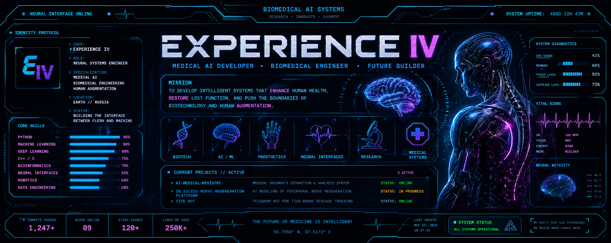
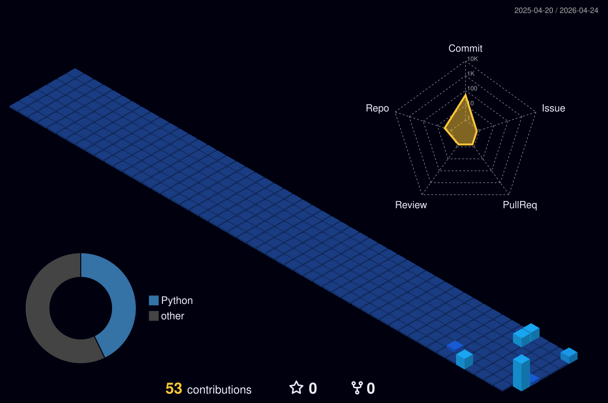

<div align="center">
  
</div>

<br>

<div align="center">


<br><br>


</div>

---

<div align="center">

## ◤ КТО ЭТО ТУТ ◢

Студент-медик из Нижнего, который пишет софт на стыке  
**ИИ, медицинских данных, бэкенда и будущих биотехнологий.**

Мечтаю о протезах, имплантах и нейроинтерфейсах.  
Клиническая медицина — не моё. Хром — моё.

</div>

---

<div align="center">

## ◤ ТЕХНОЛОГИЧЕСКАЯ МАТРИЦА ◢


<sub>Иконки не врут. Почти. Остальное гуглится за 30 секунд.</sub>

</div>

---

<div align="center">

## ◤ ОФИЦИАЛЬНО О МОЁМ УРОВНЕ ◢

| Параметр | Значение |
|---|---|
| Уровень разработчика | «Senior», если считать часы без сна |
| Любимый баг | тот, что исчез сам и никому не сказал |
| Отладка | `print("here")`, потом `print("here2")`, потом молитва |
| Рабочее время | с 22:00 до «ну я же только сел» |
| ОС | Fedora, потому что страдать надо красиво |
| Любимый язык | C++, а ещё Python, когда лень страдать |
| Код-ревью | сам себе, самый предвзятый судья в мире |
| «У меня на машине работает» | сертифицировано |

</div>

---

<div align="center">

## ◤ ACTIVE PROJECTS ◢

</div>

<table>
<tr>
<td width="50%">

### 🏥 MedReg AI

Intelligent patient routing based on neural text analysis.

**Medical complaint → symptom analysis → specialist recommendation**

<a href="https://github.com/ExperienceIV/MedReg-AI-Demo">
  
</a>

</td>
<td width="50%">

### 🕷 Tick Defender Bot

Educational Telegram bot for tick-borne encephalitis prevention and public health awareness.

**Medical education → prevention → public health**

<a href="https://github.com/ExperienceIV/Telegram-bot-for-the-prevention-of-tick-borne-encephalitis">
  
</a>

</td>
</tr>
</table>

---

<div align="center">

## ◤ ТЕЛЕМЕТРИЯ GITHUB ◢

<a href="https://github.com/ExperienceIV?tab=repositories">
  
</a>
<a href="https://github.com/ExperienceIV?tab=followers">
  
</a>
<a href="https://github.com/ExperienceIV/MedReg-AI-Demo">
  
</a>

<br><br>



</div>

---

<div align="center">

## ◤ СВЯЗЬ ◢


<br><br>

**Открыт для коллабов в MedTech / AI / биомедицинской инженерии.**  
Пишите, если нужен напарник, который сломает прод в 3:05, но починит в 3:06.

</div>

---

<div align="center">

```txt
БУДУЩЕЕ МЕДИЦИНЫ — ИНТЕЛЛЕКТУАЛЬНОЕ.
БУДУЩЕЕ ЧЕЛОВЕЧЕСКОГО ТЕЛА — ИНЖЕНЕРНОЕ.
// TODO: выспаться
```

</div>
