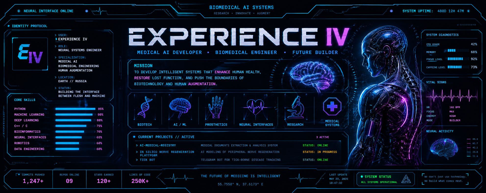
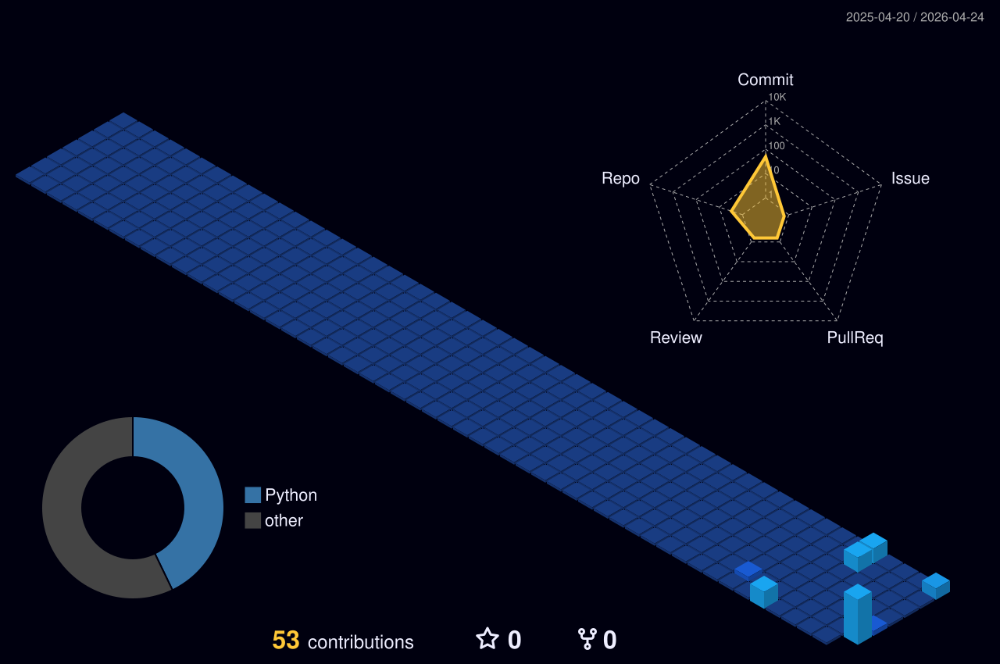

  

  # Experience IV

  **Medical AI · Biomedical Engineering · Software Development**

  Студент медицинского университета. Разрабатываю программные решения на пересечении медицины, машинного обучения и инженерии.

  [Проекты](#проекты) · [Технологии](#технологии) · [Связь](#связь)

---

## Обо мне

Основные направления работы — анализ медицинских данных, интеллектуальные системы, биомедицинская инженерия и протезирование.

Интересуюсь нейроинтерфейсами, медицинской электроникой, встроенными системами и практическим применением машинного обучения.

## Проекты

### MedReg AI

Система анализа жалоб пациента и маршрутизации к профильному специалисту с использованием методов обработки естественного языка.

**Направление:** Medical NLP · Machine Learning · Python

[Репозиторий MedReg AI](https://github.com/ExperienceIV/MedReg-AI-Demo)

### Tick Defender Bot

Образовательный Telegram-бот по профилактике клещевого энцефалита и вопросам общественного здоровья.

**Направление:** Digital Health · Public Health · Telegram Bot

[Репозиторий Tick Defender Bot](https://github.com/ExperienceIV/Telegram-bot-for-the-prevention-of-tick-borne-encephalitis)

### Радар смены — Navicon AI Fest

Прототип интеллектуального диспетчера обращений: анализ текста заявки, определение приоритета по правилам организации и маршрутизация к специалисту с учётом компетенций и загрузки.

**Направление:** Automation · Python · SQLite · Service Desk

[Репозиторий «Радар смены»](https://github.com/ExperienceIV/Navicon_AI_Fest_Case1)

## Технологии

| Область | Инструменты |
| --- | --- |
| Языки | Python, C++, Rust |
| Машинное обучение | PyTorch, Transformers |
| Backend | FastAPI, SQL |
| Инструменты | Git, GitHub, Linux / Fedora |
| Интересы в разработке | Embedded systems, медицинская электроника, нейроинтерфейсы |

## GitHub

[Все репозитории](https://github.com/ExperienceIV?tab=repositories) · [Активность](https://github.com/ExperienceIV?tab=overview) · [Подписчики](https://github.com/ExperienceIV?tab=followers)

График активности

## Связь

Открыт к научному и техническому сотрудничеству в **MedTech, AI и биомедицинской инженерии**.

[GitHub](https://github.com/ExperienceIV)
